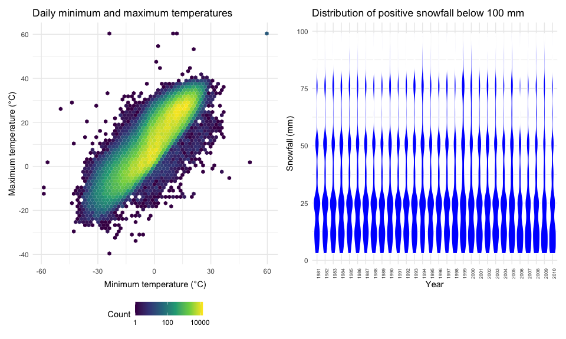
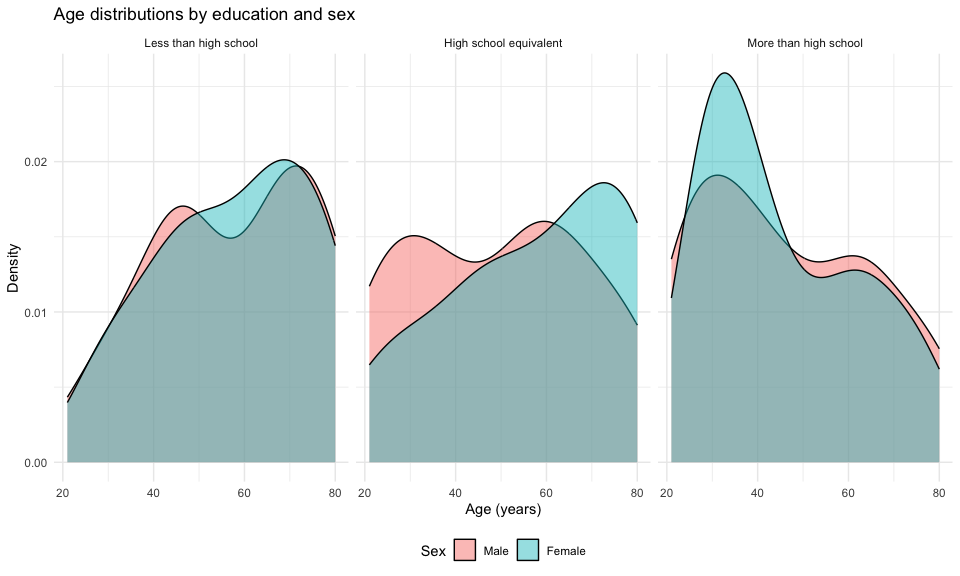
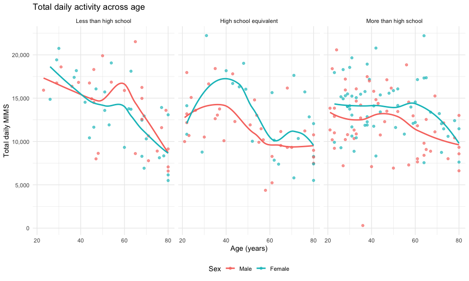
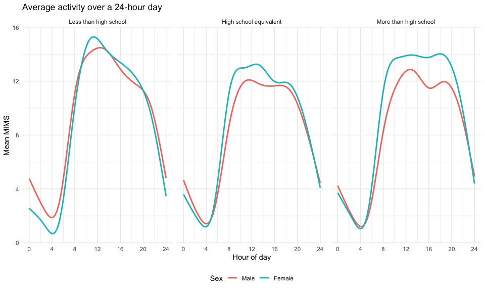
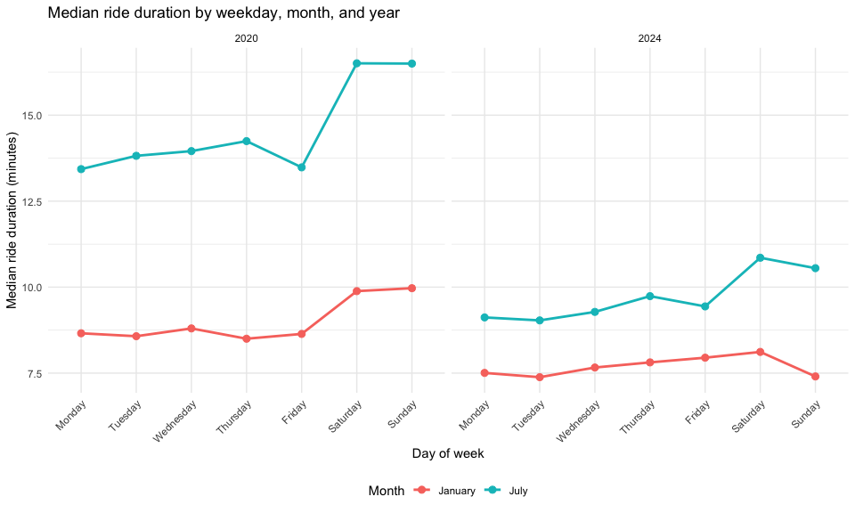
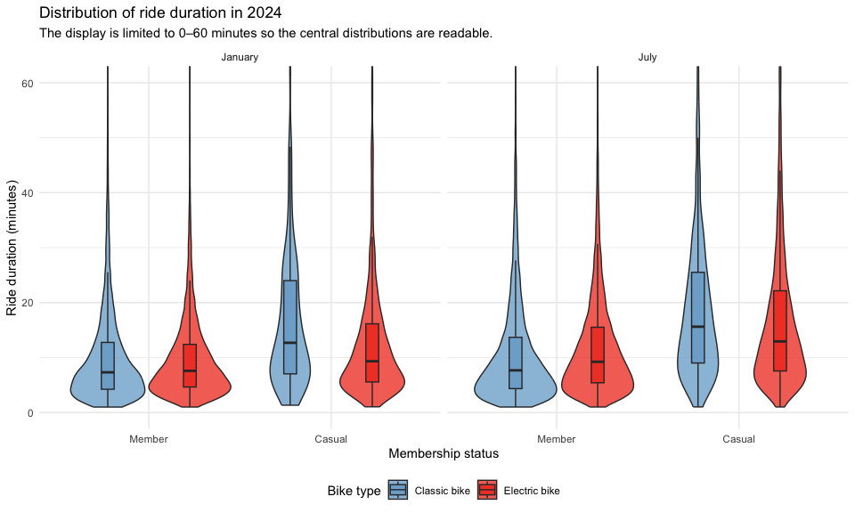

p8105_hw3
================
2026-10-15

``` r
library(tidyverse)
library(p8105.datasets)
library(patchwork)

knitr::opts_chunk$set(
  echo = TRUE,
  fig.width = 10,
  fig.height = 6,
  out.width = "95%"
)

theme_set(theme_minimal() + theme(legend.position = "bottom"))
```

# Problem 1

## Dataset description

``` r
data("ny_noaa")
noaa_dimensions <- dim(ny_noaa)
noaa_missingness <- ny_noaa |>
  summarize(across(everything(), ~ mean(is.na(.x)))) |>
  pivot_longer(
    cols = everything(),
    names_to = "variable",
    values_to = "proportion_missing"
  ) |>
  arrange(desc(proportion_missing))
knitr::kable(
  noaa_missingness,
  digits = 3,
  col.names = c("Variable", "Proportion missing"),
  caption = "Missingness in the NY NOAA dataset"
)
```

| Variable | Proportion missing |
|:---------|-------------------:|
| tmin     |              0.437 |
| tmax     |              0.437 |
| snwd     |              0.228 |
| snow     |              0.147 |
| prcp     |              0.056 |
| id       |              0.000 |
| date     |              0.000 |

Missingness in the NY NOAA dataset

The `ny_noaa` dataset contains 2,595,176 observations and 7 variables.
Each row is a daily weather record from one weather station. The key
variables are the station identifier (`id`), date, precipitation
(`prcp`), snowfall (`snow`), snow depth (`snwd`), minimum temperature
(`tmin`), and maximum temperature (`tmax`). Missing data are a
substantial concern: the highest missingness occurs in tmin, for which
43.7% of observations are missing. Any analysis based on these measures
therefore uses only the available observations for the variables
involved. \## Data cleaning and common snowfall values

``` r
noaa_clean =
  ny_noaa |>
  separate(
    date,
    into = c("year", "month", "day"),
    sep = "-",
    convert = TRUE,
    remove = FALSE
  ) |>
  # reasonable units
  mutate(
    across(c(prcp, snow, snwd, tmax, tmin), as.numeric),
    prcp = prcp / 10,
    tmax = tmax / 10,
    tmin = tmin / 10
  )

common_snowfall =
  noaa_clean |>
  filter(!is.na(snow)) |>
  count(snow, name = "number_of_days", sort = TRUE) |>
  slice_head(n = 10)

knitr::kable(
  common_snowfall,
  col.names = c("Snowfall (mm)", "Number of station-days"),
  caption = "Ten most commonly observed snowfall values"
)
```

| Snowfall (mm) | Number of station-days |
|--------------:|-----------------------:|
|             0 |                2008508 |
|            25 |                  31022 |
|            13 |                  23095 |
|            51 |                  18274 |
|            76 |                  10173 |
|             8 |                   9962 |
|             5 |                   9748 |
|            38 |                   9197 |
|             3 |                   8790 |
|           102 |                   6552 |

Ten most commonly observed snowfall values

I separated the date into numeric year, month, and day variables and
converted precipitation, maximum temperature, and minimum temperature
from tenths of their reported units to millimeters and degrees Celsius.
The most common snowfall value is 0 mm, observed on 2,008,508
station-days. This is expected because most days have no or little
snowfall. Other frequent values are small amounts or values produced by
standard measurement increments and rounding.

## Average January and July maximum tem

``` r
monthly_station_temperature =
  noaa_clean |>
  filter(month %in% c(1, 7)) |>
  mutate(
    month = factor(month, levels = c(1, 7), 
    labels = c("January", "July"))
  ) |>
  group_by(id, year, month) |>
  summarize(mean_tmax = mean(tmax, na.rm = TRUE), .groups = "drop") |>
  filter(is.finite(mean_tmax))

ggplot(
  monthly_station_temperature,
  aes(x = year, y = mean_tmax, group = id)
) +
  geom_line(alpha = 0.35, color = "green") +
  facet_grid(. ~ month) +
  labs(
    title = "Average maximum temperature by station and year",
    x = "Year",
    y = "Average maximum temperature (°C)"
  )
```


The plot shows a strong and interpretable seasonal contrast: July
maximum temperatures are much higher than January maximum temperatures.
Stations generally follow similar long-term patterns, while the vertical
spread reflects geographic differences among stations. A few
station-years are separated sharply from the main collection of lines;
these may represent unusual weather, incomplete monthly records, or
measurement problems and should be checked before being treated as
meaningful climate signals.

## Temperature relationship and snowfall distribution

``` r
temperature_plot =
  noaa_clean |>
  filter(!is.na(tmin), !is.na(tmax)) |>
  ggplot(aes(x = tmin, y = tmax)) +
  geom_hex(bins = 60) +
  scale_fill_viridis_c(trans = "log10") +
  labs(
    title = "Daily minimum and maximum temperatures",
    x = "Minimum temperature (°C)",
    y = "Maximum temperature (°C)",
    fill = "Count"
  )

snowfall_plot =
  noaa_clean |>
  filter(snow > 0, snow < 100) |>
  mutate(year = factor(year)) |>
  ggplot(aes(x = year, y = snow)) +
  geom_violin(fill = "blue", color = "white", scale = "width") +
  labs(
    title = "Distribution of positive snowfall below 100 mm",
    x = "Year",
    y = "Snowfall (mm)"
  ) +
  theme(axis.text.x = element_text(angle = 90, hjust = 1, size = 6))

temperature_plot + snowfall_plot
```


The hexbin plot is preferable to a scatterplot because the dataset
contains many overlapping observations. It shows a strong positive
relationship between minimum and maximum temperature, with the greatest
density near moderate temperatures and also some outliers on the edge of
the plot. The yearly snowfall distributions are right-skewed: small
positive snowfall amounts occur most often, while larger events below
100 mm are less common. The overall shape is broadly similar across
years, although the upper tail and concentration vary from year to year.

## Problem 2

## Importing, tidying, and merging the NHANES data

``` r
nhanes_demographics =
  read_csv(
  "nhanes_covar.csv",
  skip = 4,
  na = c("NA", ".", ""),
  show_col_types = FALSE
  ) |>
  janitor::clean_names() |>
  filter(age >= 21) |>
  drop_na(sex, age, bmi, education) |>
  mutate(
    sex = factor(sex, levels = c(1, 2), labels = c("Male", "Female")),
    education = factor(
      education,
      levels = c(1, 2, 3),
      labels = c(
        "Less than high school",
        "High school equivalent",
        "More than high school"
      ),
      ordered = TRUE
    )
  )

nhanes_activity =
  read_csv(
  "nhanes_accel.csv",
  show_col_types = FALSE
  ) |>
  janitor::clean_names() |>
  pivot_longer(
    cols = starts_with("min"),
    names_to = "minute",
    names_prefix = "min",
    values_to = "mims"
  ) |>
  mutate(minute = as.integer(minute))

nhanes_tidy =
  nhanes_demographics |>
  inner_join(nhanes_activity, by = "seqn")

nhanes_participants =
  nhanes_tidy |>
  distinct(seqn, .keep_all = TRUE)
```

After excluding participants younger than 21 and participants with
missing demographic information, the analytic dataset contains 228
participants and 328,320 participant-minute observations. The long
format preserves every demographic variable and every original
minute-level MIMS value while making time-course summaries
straightforward.

## Sex and education table and age distributions

``` r
sex_education_table =
  nhanes_participants |>
  count(education, sex) |>
  pivot_wider(names_from = sex, values_from = n, values_fill = 0) |>
  arrange(education)


knitr::kable(
  sex_education_table,
  caption = "Number of participants by education and sex"
)
```

| education              | Male | Female |
|:-----------------------|-----:|-------:|
| Less than high school  |   27 |     28 |
| High school equivalent |   35 |     23 |
| More than high school  |   56 |     59 |

Number of participants by education and sex

``` r
ggplot(nhanes_participants, aes(x = age, fill = sex),colour = age) +
  geom_density(alpha = 0.45) +
  facet_grid(~ education) +
  labs(
    title = "Age distributions by education and sex",
    x = "Age (years)",
    y = "Density",
    fill = "Sex"
  )
```

    ## Warning in fortify(data, ...): Arguments in `...` must be used.
    ## ✖ Problematic argument:
    ## • colour = age
    ## ℹ Did you misspell an argument name?


The table indicates that participants with more than a high school
education form the largest education group in this analytic sample. The
density curves also show that age composition differs by education
level, so comparisons of activity across education categories should be
interpreted with age in mind. Within each panel, the male and female
distributions overlap substantially, although their peaks and tails are
not identical.

## Total daily activity

``` r
participant_activity =
  nhanes_tidy |>
  group_by(seqn, sex, age, bmi, education) |>
  summarize(total_activity = sum(mims, na.rm = TRUE), .groups = "drop")

ggplot(
  participant_activity,
  aes(x = age, y = total_activity, color = sex)
  ) +
  geom_point(alpha = 0.65) +
  geom_smooth(method = "loess", se = FALSE, linewidth = 1) +
  facet_grid(~ education) +
  scale_y_continuous(labels = scales::label_comma()) +
  labs(
    title = "Total daily activity across age",
    x = "Age (years)",
    y = "Total daily MIMS",
    color = "Sex"
  )
```

    ## `geom_smooth()` using formula = 'y ~ x'


Total activity generally declines with age, although there is
considerable participant-level variation. The smooth curves suggest that
the size and shape of the age-related decline differ across education
groups and, in some panels, between men and women. Because these are
descriptive smooths rather than adjusted estimates, apparent differences
should not be interpreted as causal effects of sex or education. \##
Twenty-four-hour activity profiles

``` r
activity_course =
  nhanes_tidy |>
  mutate(hour = minute / 60) |>
  group_by(education, sex, minute, hour) |>
  summarize(mean_mims = mean(mims, na.rm = TRUE), .groups = "drop")

ggplot(activity_course, aes(x = hour, y = mean_mims, color = sex)) +
  geom_smooth(se = FALSE, span = 0.08, linewidth = 1) +
  facet_grid(~ education) +
  scale_x_continuous(breaks = seq(0, 24, by = 4), limits = c(0, 24)) +
  labs(
    title = "Average activity over a 24-hour day",
    x = "Hour of day",
    y = "Mean MIMS",
    color = "Sex"
  )
```

    ## `geom_smooth()` using method = 'gam' and formula = 'y ~ s(x, bs = "cs")'


Activity is lowest overnight, rises rapidly in the morning, remains
elevated through the daytime, and falls again in the evening. This
shared daily rhythm is visible in all three education groups.
Differences between men and women are smaller overnight and more
noticeable during waking hours, while the timing and height of daytime
peaks vary somewhat by education level.

# Problem 3

## Importing, cleaning, and describing the Citi Bike data

``` r
citibike_files =
  tribble(
  ~file_name, ~year, ~month,
  "Jan 2020 Citi.csv", 2020, "January",
  "July 2020 Citi.csv", 2020, "July",
  "Jan 2024 Citi.csv", 2024, "January",
  "July 2024 Citi.csv", 2024, "July"
  )

citibike_data =
  citibike_files |>
  mutate(
    ride_data = map(
      file_name,
      ~ read_csv(file.path("citibike", .x), show_col_types = FALSE)
    )
  ) |>
  unnest(ride_data) |>
  mutate(
    year = factor(year, levels = c(2020, 2024)),
    month = factor(month, levels = c("January", "July")),
    weekdays = factor(
      weekdays,
      levels = c(
        "Monday", "Tuesday", "Wednesday", "Thursday",
        "Friday", "Saturday", "Sunday"
      ),
      ordered = TRUE
    ),
    member_casual = factor(
      member_casual,
      levels = c("member", "casual"),
      labels = c("Member", "Casual")
    ),
    rideable_type = factor(
      rideable_type,
      levels = c("classic_bike", "electric_bike"),
      labels = c("Classic bike", "Electric bike")
    )
  )
```

The combined Citi Bike dataset contains 99,485 rides and 10 variables.
Each row represents one sampled ride and includes a ride identifier,
bike type, day of the week, duration in minutes, starting and ending
station names, membership status, year, and month. The dataset combines
January and July observations from 2020 and 2024, which supports
comparisons across season and year.

## Ride counts by year, month, and membership status

``` r
ride_count_table =
  citibike_data |>
  count(year, month, member_casual, name = "number_of_rides") |>
  pivot_wider(
    names_from = member_casual,
    values_from = number_of_rides,
    values_fill = 0
  ) |>
  arrange(year, month)


knitr::kable(
  ride_count_table,
  caption = "Number of rides by year, month, and membership status"
)
```

| year | month   | Member | Casual |
|:-----|:--------|-------:|-------:|
| 2020 | January |  11436 |    984 |
| 2020 | July    |  15411 |   5637 |
| 2024 | January |  16753 |   2108 |
| 2024 | July    |  36262 |  10894 |

Number of rides by year, month, and membership status

Ride counts are higher in July than in January in both years, which is
consistent with more favorable summer riding conditions. Members account
for more rides than casual riders in every year-month combination. The
sample also contains substantially more rides in 2024 than in 2020,
reflecting the system’s growth as well as the sampling design described
in the assignment. \## Five most popular starting stations in July 2024

``` r
popular_stations =
  citibike_data |>
  filter(year == "2024", month == "July", !is.na(start_station_name)) |>
  count(start_station_name, name = "number_of_rides", sort = TRUE) |>
  slice_head(n = 5)

knitr::kable(
  popular_stations,
  col.names = c("Starting station", "Number of rides"),
  caption = "Five most popular starting stations in July 2024"
)
```

| Starting station         | Number of rides |
|:-------------------------|----------------:|
| Pier 61 at Chelsea Piers |             163 |
| University Pl & E 14 St  |             155 |
| W 21 St & 6 Ave          |             152 |
| West St & Chambers St    |             150 |
| W 31 St & 7 Ave          |             146 |

Five most popular starting stations in July 2024

The most popular starting station in July 2024 is Pier 61 at Chelsea
Piers, with 163 rides in the sample. The leading stations are
concentrated at locations that plausibly generate heavy recreational or
commuter traffic, although this table describes trip origins rather than
the number of unique riders.

## Median ride duration by weekday, month, and year

``` r
median_duration =
  citibike_data |>
  group_by(year, month, weekdays) |>
  summarize(
    median_duration = median(duration, na.rm = TRUE),
    .groups = "drop"
  )


ggplot(
  median_duration,
  aes(x = weekdays, y = median_duration, color = month, group = month)
  ) +
  geom_line(linewidth = 1) +
  geom_point(size = 2.5) +
  facet_grid(~ year) +
  labs(
    title = "Median ride duration by weekday, month, and year",
    x = "Day of week",
    y = "Median ride duration (minutes)",
    color = "Month"
  ) +
  theme(axis.text.x = element_text(angle = 45, hjust = 1))
```


Median rides are generally longer in July than in January, especially on
weekends, which suggests a larger recreational component during summer.
Weekday medians are comparatively stable and shorter, consistent with
more routine transportation. Comparing the two panels also shows whether
the weekly pattern changed between 2020 and 2024 without obscuring the
seasonal contrast.

## Ride duration in 2024 by month, membership, and bike type

``` r
citibike_data |>
  filter(year == "2024") |>
  ggplot(
    aes(x = member_casual, y = duration, fill = rideable_type)
  ) +
  geom_violin(
    position = position_dodge(width = 0.9),
    trim = TRUE,
    alpha = 0.75
  ) +
  geom_boxplot(
    width = 0.14,
    outlier.shape = NA,
    position = position_dodge(width = 0.9),
    alpha = 0.8
  ) +
  facet_grid(~ month) +
  coord_cartesian(ylim = c(0, 60)) +
  scale_fill_manual(
    values = c("Classic bike" = "#74A9CF", "Electric bike" = "#F03B20")
  ) +
  labs(
    title = "Distribution of ride duration in 2024",
    subtitle = "The display is limited to 0–60 minutes so the central distributions are readable.",
    x = "Membership status",
    y = "Ride duration (minutes)",
    fill = "Bike type"
  )
```


Casual riders tend to take longer trips than members, particularly in
July. Electric-bike rides are generally more concentrated at shorter
durations than classic-bike rides, which may reflect faster travel or
different use cases. July distributions are wider and have higher
centers than January distributions, especially for casual riders. The
y-axis restriction changes only the displayed range; it does not remove
observations from the computation of the violin and boxplot summaries.
